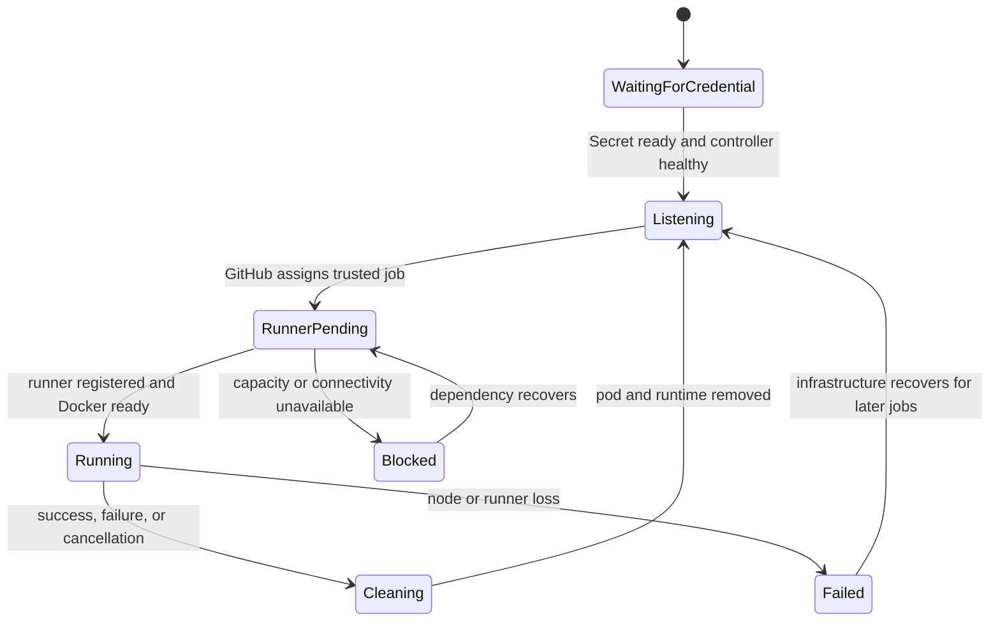

# Data Model: Self-Hosted GitHub Actions Runner

This feature stores desired configuration and disposable execution state, not application data.
ARC owns generated child resources; Git owns chart inputs and supporting policy/secret references.

## Entities and ownership

| Entity                    | Fields and relationships                                                                              | Owner / lifetime                                                     |
| ------------------------- | ----------------------------------------------------------------------------------------------------- | -------------------------------------------------------------------- |
| Controller application    | `arc-system`; service account `actions-runner-controller`; watches `arc-runners`                      | Git/ArgoCD; installed before scale set                               |
| Namespaces                | `arc-system`; `arc-runners` with explicit privileged admission label                                  | Controller app owns both; retained until scale set finalizers finish |
| Runner scale set          | `home-ops`; repository URL; credential Secret name; min 0, max 2; runner template                     | Git/ArgoCD; one initial set                                          |
| Registration credential   | 1Password item `home-ops-runner`, property `github_token`; Kubernetes Secret `home-ops-runner-github` | ESO; registration only                                               |
| Listener                  | Watches GitHub work queue; scales ephemeral runner sets; scoped RBAC                                  | ARC-generated; long-running                                          |
| Ephemeral runner          | One job; JIT registration; no-permission service account; no API token; custom labels                 | ARC-generated; removed after work                                    |
| Docker daemon             | Privileged native sidecar; Unix socket; own data directory; shared workspace                          | Within one runner pod; discarded with pod                            |
| Workspace/runtime volumes | Work 4Gi; Docker data 10Gi; externals 1Gi; socket 16Mi                                                | Disk-backed emptyDir; never reused across pods                       |
| Diagnostics               | Namespace, pod, container, time, runner/job identity where emitted                                    | Alloy/Loki; existing seven-day retention                             |
| Workflow run              | Repository, default-branch ref, job, runner name, status, full step logs                              | GitHub; separate from Loki diagnostics                               |

## Validation rules

- Repository URL must equal `https://github.com/juftin/home-ops` for initial rollout.
- `runnerScaleSetName` and workflow `runs-on` must both equal `home-ops`.
- `0 <= minRunners <= maxRunners`; initial values are 0 and 2.
- The credential value exists only in 1Password and ESO-managed Secret data; chart values contain
  the Secret name. Job templates must not reference that Secret.
- Both controller service account name/namespace must match the scale-set RoleBinding inputs.
- The chart controller watch namespace must match the namespace that holds the runner set.
- Exactly one ArgoCD app owns each Namespace; runner resources depend on controller app namespace creation.
- All runner images, including externals-copy init image, use the same pinned release.
- Only the `dind` container may be privileged; job pods cannot mount host paths, host sockets,
  or service account tokens. They cannot use host network/PID/IPC namespaces.
- All containers have budgets. Namespace quota includes listener and restartable-init-sidecar accounting.
- Default-branch smoke jobs have no externally supplied checkout ref or shell input.

## State transitions

This does not promise replay of a failed job. GitHub reports its result; a maintainer may rerun it.
Token rotation changes the ESO Secret and must be verified through a fresh registration. If
control components cache authentication, use documented controlled restarts after active work drains.
Remove the runner set while the controller and valid credentials are still present; remove the
controller and namespaces only after generated resources and finalizers have cleared.
