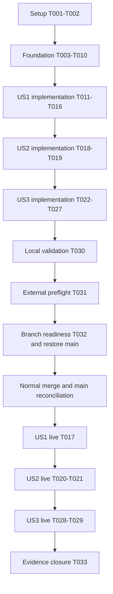

# Tasks: Self-Hosted GitHub Actions Runner

**Input**: Design documents in `/specs/006-github-actions-runner/`
**Prerequisites**: [plan.md](plan.md), [spec.md](spec.md), [research.md](research.md),
[data-model.md](data-model.md), [configuration contract](contracts/runner-configuration.md),
[workflow contract](contracts/workflow.md), and [quickstart.md](quickstart.md).
**Created**: 2026-10-17

**Organization**: Implementation and acceptance tasks are grouped by the three specification
stories. Smoke verification is explicitly required by the specification; no unrelated test
framework or custom runner image pipeline is introduced.

## Format and execution rules

Each task uses `- [ ] Tnnn [P?] [USn?] description with file paths`. `[P]` identifies independent
file work available after its stated prerequisites. Paths are relative to the repository root.

Only task generation is performed by `/speckit.tasks`. All implementation and live tasks below
remain unchecked. Existing planning files and agent-context edits must be preserved.

Live story checks are deferred until the release gate below; their location within story phases
expresses traceability, not permission to deploy unfinished infrastructure. Never weaken the
main-branch guard to make branch testing execute unmerged workflow code.

## Phase 1: Setup

**Purpose**: Confirm repository conventions and freeze implementation inputs.

- [ ] T001 Review `Taskfile.yaml`, `.taskfiles/dev/Taskfile.yaml`, `kubernetes/argocd/applicationset.yaml`, and `scripts/render-argocd-app.sh`; confirm the existing feature worktree and record baseline check results in `specs/006-github-actions-runner/verification.md` without reading secret files.
- [ ] T002 Reconfirm chart/image compatibility and resolve immutable runner/Docker image pins using official upstream metadata; record selected versions, sources, Docker Hub/CDN FQDNs, and Cilium DNS/private-deny details in `specs/006-github-actions-runner/research.md` and `specs/006-github-actions-runner/contracts/runner-configuration.md` before writing dependent manifests.

**Checkpoint**: Inputs are concrete; no floating image tags, undeclared network dependencies,
or new runtime tools are necessary.

## Phase 2: Foundation

**Purpose**: Build the controller and shared security/registration prerequisites.

- [ ] T003 Create `kubernetes/apps/arc-system/actions-runner-controller/app/namespaces.yaml` owning both `arc-system` and `arc-runners` at resource sync wave -2; explicitly label `arc-runners` for privileged Pod Security Admission and avoid duplicate namespace ownership.
- [ ] T004 [P] Create `kubernetes/apps/arc-system/actions-runner-controller/app/values.yaml` with fixed service account `actions-runner-controller`, single-namespace watch of `arc-runners`, one replica, plan resource budgets, and controller diagnostics configuration.
- [ ] T005 [P] Create `kubernetes/apps/arc-system/actions-runner-controller/app/ciliumnetworkpolicy.yaml` permitting only required controller DNS, GitHub HTTPS, and Kubernetes API access with selectors matched to the selected chart.
- [ ] T006 Create `kubernetes/apps/arc-system/actions-runner-controller/app/kustomization.yaml` with the pinned official OCI controller chart, CRDs, and namespace/policy resources; do not use parent references or a Kustomize namespace transformer that rewrites cross-namespace RBAC (depends on T003, T004, T005).
- [ ] T007 [P] Add `arc-system` wave 3 and `arc-runners` wave 4 to `kubernetes/argocd/applicationset.yaml`; preserve explicit namespace ownership and leave namespace auto-creation disabled for both ARC apps.
- [ ] T008 [P] Create `kubernetes/apps/arc-runners/home-ops-runner/app/externalsecret.yaml` named `home-ops-runner`, using `ClusterSecretStore/onepassword`, item `home-ops-runner`, property/key `github_token`, and target `home-ops-runner-github`; follow the contract's refresh and ownership/retention settings without embedding a token.
- [ ] T009 [P] Create `kubernetes/apps/arc-runners/home-ops-runner/app/ciliumnetworkpolicy.yaml` with distinct runner/listener selectors, default deny, CoreDNS DNS rules, declared HTTPS FQDNs, and private/LAN/host/API denial for jobs; preserve the DNS exception against deny precedence and permit necessary listener API access.
- [ ] T010 [P] Create `kubernetes/apps/arc-runners/home-ops-runner/app/resourcequota.yaml` with the plan's aggregate request/limit budgets; account for listener overhead and restartable init-container accounting without a restrictive pod-count quota (can precede T014).

**Execution order**: T003, T004, T005, T007, T008, T009, and T010 can proceed once Setup is complete;
T006 follows T003/T004/T005. No app is activated yet.

**Checkpoint**: The two namespaces have one owner, the controller renders without live lookup,
and registration and network policies are ready to be consumed by the runner app.

## Phase 3: User Story 1 — Execute Repository Jobs (Priority: P1, MVP)

**Goal**: Run trusted repository jobs with shell, JavaScript, Docker builds, container actions,
job containers, and service containers.

**Independent test**: After the release gate, manually dispatch the main-branch smoke workflow
three times. Every requested execution mode succeeds, results appear in GitHub, and warm-image
jobs start within five minutes. Existing hosted PR checks retain their runner selection.

- [ ] T011 [P] [US1] Create `.github/runner-smoke/Dockerfile` using a pinned public base image and deterministic synthetic output for local build/run assertions; require no registry publication or credentials.
- [ ] T012 [P] [US1] Create `.github/runner-smoke/action/action.yaml` and `.github/runner-smoke/action/Dockerfile` defining a local container action with input, workspace access, output through `GITHUB_OUTPUT`, and a deterministic failure case.
- [ ] T013 [P] [US1] Create `kubernetes/apps/arc-runners/home-ops-runner/app/values.yaml` for repository `juftin/home-ops`, runner name `home-ops`, Secret reference, explicit controller service account namespace/name, min 0/max 2, and customized pinned DinD template with automatic `containerMode` unset; include startup readiness, shared socket/work/externals volumes, separate Docker data emptyDir, all plan resource budgets, no-permission runner SA, and disabled token automount; only DinD may be privileged and no host mounts/namespaces are allowed.
- [ ] T014 [US1] Create `kubernetes/apps/arc-runners/home-ops-runner/app/kustomization.yaml` with the pinned scale-set OCI chart and supporting secret/policy/quota resources; order prerequisites before the runner set and render without controller discovery lookup (depends on T008, T009, T013, T010).
- [ ] T015 [US1] Create `.github/workflows/runner-smoke.yaml` covering shell/checkout/JavaScript, Docker build/run, local container action success/failure propagation, host-job service via localhost, and job-container service via service name; use manual dispatch only, per-job main-ref guards, explicit main checkout, nonpersistent checkout credentials, read-only contents permission, pinned actions/images, and timeouts; accept no arbitrary ref or shell inputs (depends on T011, T012).
- [ ] T016 [US1] Review isolated renders of both ARC `app/kustomization.yaml` files through the existing renderer; record chart versions, watched-namespace RBAC, explicit RoleBinding targets, namespace ownership, token/secret exclusion, DinD privileges, resource/storage declarations, and workflow trust invariants in `specs/006-github-actions-runner/verification.md` (depends on T014, T015).
- [ ] T017 [US1] After the release gate, dispatch `.github/workflows/runner-smoke.yaml` on `main` three times and record URLs, runner identities, queue/start times, all container capability outcomes, and unchanged hosted PR checks in `specs/006-github-actions-runner/verification.md`; verify another-branch dispatch skips runner jobs rather than executing code there.

**Checkpoint**: US1 implementation is independently reviewable before live execution. A successful
MVP still includes Foundation isolation and quota; resource safety is not
postponed until after deployment.

## Phase 4: User Story 2 — Scale Without Retaining Job State (Priority: P2)

**Goal**: Keep capacity bounded and discard every job's workspace and Docker state.

**Independent test**: Queue three jobs against the two-runner limit, verify a fresh runner for
later work, cancel a running job, and observe zero job runners/containers within five minutes.

- [ ] T018 [US2] Extend `.github/workflows/runner-smoke.yaml` with three independent bounded-duration execution slots, runner identity/time reporting, and marker/container-state assertions that detect reuse in subsequent jobs; avoid workflow concurrency serialization or `max-parallel` settings that would hide the ARC limit (depends on T015).
- [ ] T019 [US2] Document capacity review, zero-idle behavior, editable min/max limits, quota calculations, nested Docker cgroup checks, kubelet eviction caveats, and cancellation/state-cleanup verification in `docs/GITHUB-RUNNER-SETUP.md` (depends on T013, T010, T018).
- [ ] T020 [US2] After the release gate, use `.github/workflows/runner-smoke.yaml` to demonstrate at most two concurrent executions, successful queued third work, new identities/state absence, and cleanup after completion and cancellation; record timestamps and sanitized observations in `specs/006-github-actions-runner/verification.md`.
- [ ] T021 [US2] After the release gate, verify policy denial from runner and nested containers to a known unrelated service, private LAN destination, and Kubernetes API; verify required HTTPS/DNS still works, no job API token/registration credential is mounted, and nested Docker processes use intended resource accounting; record results in `specs/006-github-actions-runner/verification.md` without stressing the shared node or reading Secret values.

**Checkpoint**: Both normal completion and cancellation are covered. Resource declarations alone
do not count as evidence of live cgroup containment or instantaneous storage quotas.

## Phase 5: User Story 3 — Operate Through GitOps (Priority: P2)

**Goal**: Make setup, upgrades, diagnostics, rotation, recovery, and removal reproducible.

**Independent test**: Follow the setup guide, identify registration and scheduling failures from
status/logs, rotate credentials, complete a new job, and verify ordered removal preserves hosted CI.

- [ ] T022 [P] [US3] Group compatible controller/scale-set chart updates in `.renovaterc.json5` using the existing Kustomize dependency extraction; confirm the custom PodSpec image pins are Renovate-visible without introducing duplicate version sources.
- [ ] T023 [US3] Complete `docs/GITHUB-RUNNER-SETUP.md` with fine-grained token permissions/expiry and 1Password item setup, controller-first activation, explicit runner selector, trust/privilege limits, failure diagnosis, credential refresh/restart recovery, and ordered drain/removal while finalizers can still use controller and credentials (depends on T019).
- [ ] T024 [US3] Preserve `ACTIONS_RUNNER_PRINT_LOG_TO_STDOUT=1` and appropriate runner/listener labels in `kubernetes/apps/arc-runners/home-ops-runner/app/values.yaml`; confirm existing `kubernetes/apps/observability/alloy/app/values.yaml` discovers these pods without collector changes, and document Loki diagnostics versus GitHub step logs in `docs/GITHUB-RUNNER-SETUP.md` (depends on T013, T023).
- [ ] T025 [P] [US3] Add ARC to the component inventory in `README.md` with a link to `docs/GITHUB-RUNNER-SETUP.md`.
- [ ] T026 [P] [US3] Update `docs/ARCHITECTURE.md` with both namespaces, controller ownership of namespace manifests, scoped RBAC, ESO credentials, ephemeral DinD execution, resource/trust limits, and existing diagnostics collection.
- [ ] T027 [US3] Review the complete operator procedure in `docs/GITHUB-RUNNER-SETUP.md` against `specs/006-github-actions-runner/quickstart.md`; make setup, expiration/revocation diagnosis, selector/capacity/network diagnosis, rotation, and removal steps executable without printing secret values or using manual applies (depends on T023, T024).
- [ ] T028 [US3] After the release gate, run a benign failed smoke job and diagnose a controlled registration/connectivity failure; verify controller/listener status and retained runner diagnostics after pod deletion, plus separate GitHub step output; record Loki queries, timestamps, configured retention, and observed results in `specs/006-github-actions-runner/verification.md` without claiming seven days of observed retention immediately.
- [ ] T029 [US3] During a scheduled acceptance exercise after the release gate, follow `docs/GITHUB-RUNNER-SETUP.md` to rotate the external credential, prove fresh registration/job success, drain and remove runner resources before controller/namespace cleanup, and confirm hosted PR checks remain usable; record evidence in `specs/006-github-actions-runner/verification.md` and restore desired GitOps configuration if continued operation is intended.

**Checkpoint**: Operational documentation is complete before rollout. Rotation/removal exercises
remain pending until performed; reviewing their instructions is not equivalent to passing them.

## Phase 6: Validation and Release Gates

**Purpose**: Finish checks before any activation and preserve honest acceptance status.

- [ ] T030 Run `task lint` and explicit pre-commit checks for new untracked files, followed by `task dev:validate` and `task dev:validate:ci` using `Taskfile.yaml` entrypoints; inspect final diffs and record results/limitations in `specs/006-github-actions-runner/verification.md`; missing age-key decryption must remain a stated gap, and chart CRs need the explicit T016 review because schema validation excludes them.
- [ ] T031 Complete the external preflight documented in `docs/GITHUB-RUNNER-SETUP.md`: operator provisions the repository-selected token directly into 1Password, secure tooling provides required local keys/configs, and read-only capacity/status checks confirm two-runner headroom and healthy ESO/Cilium/logging; record only nonsecret readiness evidence in `specs/006-github-actions-runner/verification.md`.
- [ ] T032 Once implementation checks and preflight pass and branch activation is authorized, use `.taskfiles/dev/Taskfile.yaml` tasks to start controller-first branch testing, verify CRDs/controller/ESO/listener readiness, sync adjustments through Git, and always restore `main` with `task dev:stop` on success or failure; record readiness and restored refs in `specs/006-github-actions-runner/verification.md`.
- [ ] T033 After merge and main reconciliation, complete T017, T020, T021, T028, and T029; reconcile every FR/SC against evidence, update task completion honestly, and record remaining post-merge observations in `specs/006-github-actions-runner/verification.md` before declaring the feature accepted.

**Release gate**: T030 and T031 precede T032. The implementation must be merged through the
normal repository workflow and reconciled from `main` before live workflow acceptance. If branch activation is unavailable, keep
T032 pending and use the normal merged rollout; do not claim branch testing happened.

## Dependencies and Execution Order

- Setup blocks manifests; Foundation includes quota and blocks app integration. T006 follows
  T003/T004/T005; T014 follows T008/T009/T010/T013. Implementation tasks follow dependency
  order; story acceptance tasks explicitly wait for the release gate.
- US1 fixtures and runner template are independent files. Quota is already in Foundation;
  bounded resources are required for the MVP. US2 workflow changes follow the US1 workflow.
- US3 guide completion follows US2 capacity documentation. T024 follows T013; never edit the
  same values/workflow/guide file concurrently. README and architecture edits are independent.
- T016 is an initial render review; T030 validates the final combined implementation after all
  stories. Live tasks share `verification.md` and run sequentially to preserve reliable evidence.
- Merge is an external milestone, not an automatically executed task. Post-merge live checks
  depend on actual main deployment, not merely a successful branch readiness check.

## Parallel Execution Examples

These are opportunities for independent file work, not instructions to spawn agents.

| Story / stage | Work that can run together                                                                                    | Preconditions                                                      |
| ------------- | ------------------------------------------------------------------------------------------------------------- | ------------------------------------------------------------------ |
| Foundation    | T004 controller values; T007 discovery; T005 controller policy; T008 credential reference; T009 runner policy | T001–T002 complete                                                 |
| US1           | T011 build fixture; T012 local action; T013 runner template                                                   | Foundation complete                                                |
| US2           | T018 workflow exercises alongside US3 T025 README/T026 architecture                                           | T015 complete; paths/names fixed; capacity guide T019 follows T018 |
| US3           | T022 Renovate; T025 README; T026 architecture                                                                 | Paths/names fixed; no same-file writer                             |

US2 has no independent implementation tasks within the story: T019 follows T018. Its workflow
work may overlap independent US3 inventory edits. T019/T023/T024/T027 all touch the setup guide
and must be serialized; T024 also follows the initial runner template T013. Live acceptance is not
parallelized because concurrency, cancellation, rotation, and teardown change the same service.

## Requirement Coverage

| Requirement                                       | Implementation / acceptance tasks  |
| ------------------------------------------------- | ---------------------------------- |
| FR-001 repository-only ARC                        | T004–T007, T013–T017               |
| FR-002 stable selection and dispatch              | T013, T015, T017, T023             |
| FR-003 all container capabilities                 | T011–T015, T017                    |
| FR-004 one job and cleanup                        | T013, T018, T020                   |
| FR-005 bounded scaling                            | T010, T013, T018–T020              |
| FR-006 resource budgets                           | T004, T013, T010, T019, T021, T031 |
| FR-007 namespace/credential isolation             | T003–T006, T008, T013, T016, T021  |
| FR-008 network restriction and privilege limits   | T002, T005, T009, T016, T021, T023 |
| FR-009 external credentials and rotation          | T008, T023, T027, T029, T031       |
| FR-010 GitOps and dependency updates              | T006–T007, T014, T022, T030, T032  |
| FR-011 trusted code and hosted PR continuity      | T015–T017, T023, T029              |
| FR-012 diagnosis and retained logs                | T024, T027–T028                    |
| FR-013 operator and inventory documentation       | T019, T023–T027                    |
| SC-001 and SC-002 successful/timely smoke runs    | T017                               |
| SC-003 queue bound and cleanup                    | T020                               |
| SC-004 state/network/credential isolation         | T020–T021                          |
| SC-005 retained diagnostics and failure diagnosis | T028                               |
| SC-006 rotation and removal                       | T029                               |
| SC-007 trusted workflow selection                 | T015–T017                          |

## Implementation Strategy

1. Complete Setup and Foundation, then US1, with quota already in Foundation. This is the smallest reviewable MVP
   supporting every requested container capability with resource/security defaults in place.
2. Complete US2 exercise support and US3 operations before activation. Carry the documented DinD
   privilege exception into the implementation PR; existing platform manifests stay unchanged
   unless a measured acceptance failure requires a targeted fix.
3. Complete final lint/render checks and external preflight; retain any missing-secret limitation
   rather than silently substituting placeholder checks for full decryption.
4. Verify branch readiness only through the repository workflow, always restore `main`, and
   perform guarded smoke acceptance after merge. Record live results separately from static review.
5. Close the feature only when all required acceptance evidence exists. Do not mark future live
   tasks done merely because manifests, instructions, or a workflow were written.
